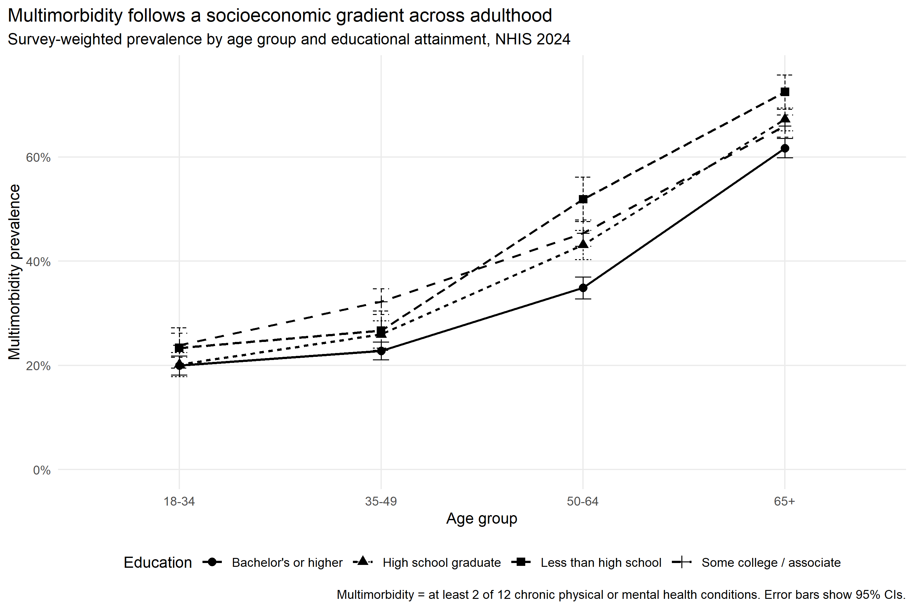
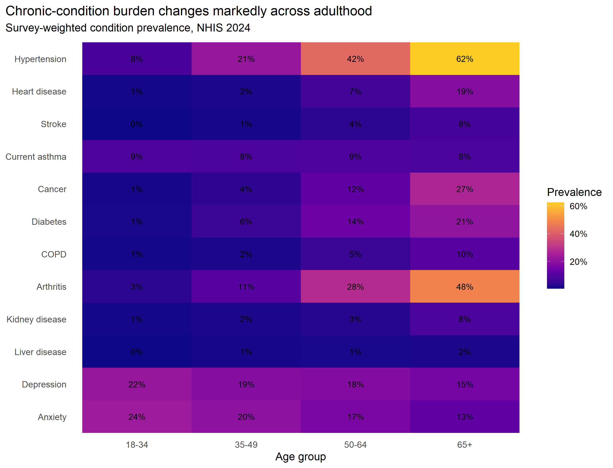
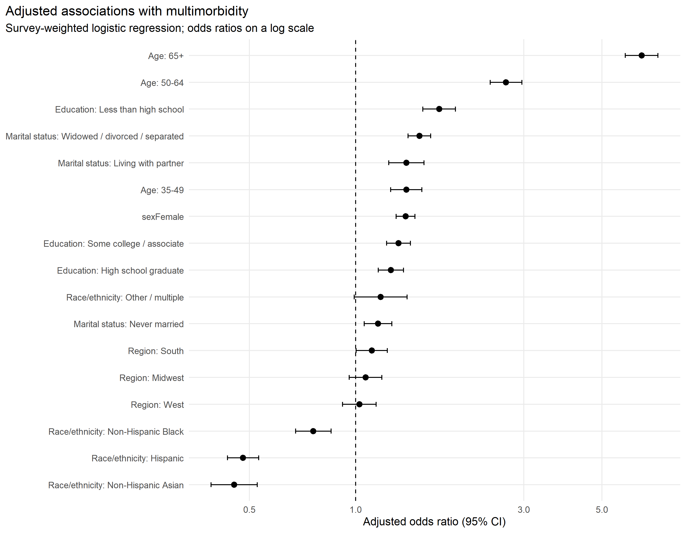

# Socioeconomic Stratification and Multimorbidity Across Adulthood in the United States

A reproducible quantitative health-sociology project using the **2024 National Health Interview Survey (NHIS)** public-use microdata from CDC/NCHS.

**Primary tool:** R  
**Methods:** complex-survey analysis, multiple imputation, survey-weighted logistic regression, quasi-Poisson count regression, interaction analysis, sensitivity analysis, publication-style visualization

## Project question

How is socioeconomic disadvantage associated with multimorbidity among U.S. adults, and does that association vary across stages of adulthood?

The project focuses on two socioeconomic dimensions:

- **Educational attainment**, including an education × age-group interaction
- **Family poverty**, using all 10 CDC multiply imputed income datasets

This is a **portfolio research project**, not the publication-track study in the broader portfolio roadmap.

## Headline findings

- Survey-weighted multimorbidity prevalence was **37.7%** (95% CI: 36.9% to 38.5%).
- Adults with **less than high school education** had higher adjusted odds of multimorbidity than adults with a bachelor's degree or higher: **OR 1.73** (95% CI: 1.55 to 1.92).
- The education-by-age interaction was jointly significant: **F = 5.06, p < 0.001**, indicating that educational inequalities were not constant across adulthood.
- The descriptive education gap was especially pronounced in **midlife**. Among adults aged 50–64, estimated multimorbidity prevalence was **51.9%** for those with less than high school education versus **34.9%** for those with a bachelor's degree or higher.
- In the multiply imputed income model, adults below **100% of the federal poverty level** had approximately twice the adjusted odds of multimorbidity compared with adults at 400%+ FPL: **OR 2.08** (95% CI: 1.85 to 2.35).
- The composition of chronic-condition burden changed markedly with age. Hypertension, arthritis, cancer, diabetes and heart disease rose strongly with age, while diagnosed anxiety and depression were more prevalent in younger adults.

These are **cross-sectional associations**. They should not be interpreted as causal effects or within-person life-course trajectories.

## Key figures

### Education and multimorbidity across adulthood


### Chronic-condition profile by age


### Adjusted associations


## Data

The project uses official CDC/NCHS public-use data:

- **2024 NHIS Sample Adult file:** 32,629 respondents
- **2024 NHIS Adult Imputed Income file:** 326,290 rows, representing 10 imputations per respondent

The QA pipeline confirmed:

- 32,629 unique Sample Adult records
- 10 income imputations per adult
- no negative survey weights
- 32,294 respondents with a complete multimorbidity outcome
- a weighted adult population of approximately 259.7 million

Raw CDC data are not stored in the repository. The analysis pipeline downloads them from the official source.

## Multimorbidity definition

The primary outcome is **two or more of 12 chronic physical or mental health conditions**:

hypertension, heart disease, stroke, current asthma, cancer, diabetes, COPD, arthritis, kidney disease, liver disease, depression, and anxiety.

A physical-only multimorbidity definition excluding depression and anxiety is included as a sensitivity analysis.

## Statistical design

All descriptive estimates and models account for the NHIS complex sample design using:

- final annual Sample Adult weight (`WTFA_A`)
- pseudo-PSU (`PPSU`)
- pseudo-stratum (`PSTRAT`)

The modelling workflow includes:

1. survey-weighted descriptive estimates
2. demographic-adjusted logistic regression
3. full main-effects logistic regression
4. education × age-group interaction model
5. survey-weighted quasi-Poisson condition-count model
6. physical-only multimorbidity sensitivity analysis
7. family-poverty model pooled across all 10 income imputations using Rubin's rules

## Reproduce the project

Open `project_03_nhis_multimorbidity.Rproj` in RStudio and run:

```r
source("run_all.R")
```

The script downloads the official NHIS files, prepares the analytical data, performs QA, runs the survey-weighted models, pools the income imputations, and regenerates all tables and figures.

The download script uses a 10-minute timeout and checks ZIP integrity before extraction to make the workflow more robust on slower connections.

## Repository structure

```text
.
├── R/
│   ├── 00_dependencies.R
│   ├── 01_download_data.R
│   ├── 02_prepare_data.R
│   ├── 03_descriptive_analysis.R
│   ├── 04_models_main.R
│   ├── 05_models_income_mi.R
│   ├── 06_figures.R
│   └── 07_qa.R
├── data/
│   ├── raw/               # downloaded locally; excluded from Git
│   └── processed/         # reproducible analysis objects; RDS excluded from Git
├── docs/
│   ├── analysis_plan.md
│   ├── variable_dictionary.md
│   ├── reproducibility.md
│   ├── research_context.md
│   ├── results_summary.md
│   └── portfolio_case_study.md
├── outputs/
│   ├── figures/
│   ├── tables/
│   └── logs/
├── project_03_nhis_multimorbidity.Rproj
└── run_all.R
```

## Interpretation boundaries

- NHIS is cross-sectional, so age-group contrasts are not longitudinal life-course change.
- Chronic conditions are based on public-use self-reported/diagnosis variables and may reflect differences in healthcare access, diagnosis and reporting.
- The primary multimorbidity measure includes mental-health conditions; the physical-only sensitivity analysis is therefore important.
- Odds ratios should not be interpreted as risk ratios when the outcome is common.
- Race/ethnicity coefficients are descriptive adjusted associations, not biological effects and not evidence of causal protection or harm.

## Data source

CDC/NCHS, 2024 National Health Interview Survey public-use files. See `docs/reproducibility.md` for official links and technical documentation.
